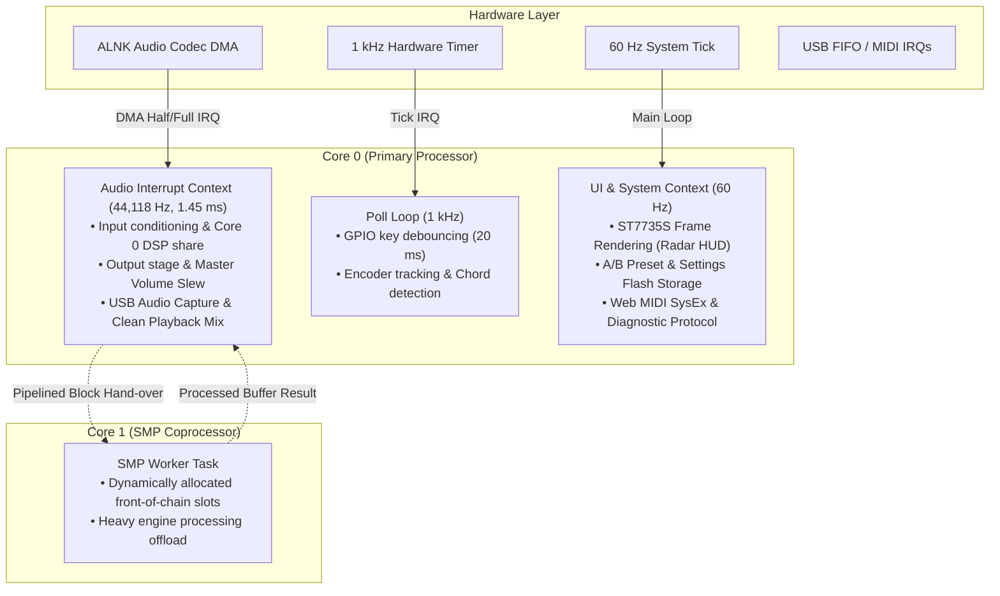

# Andromeda Architecture & System Specification

How the Andromeda firmware is architected: operating system paradigm, execution contexts, dual-core SMP scheduler, audio processing pipeline, memory topology, front-panel user interface, and host simulation tooling.

The firmware targets the JieLi AC791N SoC (dual pi32v2 cores, 512 KB SRAM, 1 MB SPI-NOR flash) driving an ST7735S 240×240 color display, ALNK I2S audio codec, GPIO pushbuttons, rotary encoder, and USB composite peripheral.

---

## 1. System Layers & Directory Topology

Hardware access is strictly isolated behind `custom-fw/include/pa_plat.h`. Portable DSP, sound engines, and system logic never access hardware registers directly; register reads/writes and interrupt trampolines are confined to `src/board/`.

```
custom-fw/
├── include/       Firmware interfaces, configuration, engine parameters, UI & preset definitions
├── src/board/     Hardware abstraction: ST7735S LCD, ALNK audio codec, SPI-NOR, GPIO, USB & BLE
├── src/dsp/       Fixed-point math primitives, biquad filters, pitch detection, tuner engine
├── src/fx/        The 6 ambient sound engines, FDN reverb, shimmer, and two-core dynamic allocator
├── src/sys/       Audio core, dual-core SMP task runner, presets, A/B flash store, SysEx, diagnostics
├── emu/           Native desktop emulator DLL (andromeda_emu.dll), Jonas Hemmersbach DIs, HTML5 UI
├── wasm/          WebAssembly DSP build (andromeda.wasm) and browser workbench
├── tools/         Build system, packaging utilities, flash recovery tools, and performance monitors
└── test/          Automated C and Python regression suites and host simulation harnesses
```

| Subsystem | Source Path | Responsibilities |
|---|---|---|
| **Board Drivers** | `src/board/` | Entry points and vector tables (`entry.S`), ALNK DMA audio driver (`audio_alnk.c`), ST7735S 240×240 display controller (`st7735s.c`), button & encoder debouncer (`gpio_scan.c`), SPI-NOR flash controller with write fence (`spi_nor.c`), USB composite driver (`usb_dev.c`, `usb_ble.c`), optional BLE radio stack (`ble_*`), Celestial Radar display renderer (`ui_cosmic.c`), and core 1 bootloader (`cpu1.c`). |
| **DSP Core** | `src/dsp/` | Fixed-point math primitives (`fixedpoint.h`), biquad parametric filters (`pa_biquad.c`), chromatic tuner autocorrelator (`pa_tuner.c`), and hardware math accelerator wrappers. |
| **Sound Engines** | `src/fx/` | Dynamic effect graph allocator (`fx_graph.c`), Andromeda effect host (`fx_andromeda.c`), six sound-design engines (`v1_glass.c`, `v1_bloom.c`, `v1_accretion.c`, `v1_choir.c`, `v1_fracture.c`, `v1_constellation.c`), algorithmic FDN reverb (`v1_fdn.c`), and recirculating shimmer (`v1_shimmer.c`). |
| **System Services**| `src/sys/` | Dual-core audio orchestrator (`pa_audio_core.c`), A/B fail-safe preset store (`pa_store.c`, `settings.c`), SysEx communication (`sysex.c`), real-time diagnostic channel (`pa_diag.c`), SMP Core 1 worker task (`smp_cpu1.c`), and telemetry measurement (`pa_meas.c`). |

---

## 2. Operating System & Execution Contexts

Andromeda operates without a heavy RTOS, using a deterministic, multi-rate cooperative architecture across four execution contexts:



| Context | Frequency | Period | Responsibilities |
|---|---|---|---|
| **Audio Interrupt (Core 0)** | 44,118 Hz | 1.451 ms (64 frames) | Runs highest priority (`isr_alnk0`). Processes input blocks, executes Core 0's share of the DSP graph, mixes USB playback, applies master volume slew with dither, and feeds DAC DMA. |
| **Core 1 SMP Worker** | Per block (on demand) | 1.451 ms | Executes the front slots of the DSP chain when split by the dynamic allocator. Operates lock-free via cache-coherent mailbox. |
| **Input Scanner** | 1,000 Hz | 1.0 ms | Debounces physical buttons, tracks encoder quadrature transitions, detects long holds (0.8s, 1.2s, 1.5s, 3.0s) and multi-button chords. |
| **UI & Background Thread** | 60 Hz | 16.6 ms | Main cooperative loop (`pa_main_loop`). Renders display frames, executes preset switches, handles flash writes (A/B commit), and services SysEx messages. |

---

## 3. Audio Path & Sound Engines

### 3.1 Signal Flow

Every 64-sample block (1.45 ms at 44.118 kHz) traverses `pa_audio_core_process_block`:

1. **Preset & Transition Crossfade:** Pending preset swaps or engine changes crossfade to zero across 32 samples to prevent clicks or DC thumps.
2. **Measurement Injection:** Internal diagnostic tone generator replaces dry input when auditing latency, THD, or DSP performance.
3. **Chromatic Tuner Tap:** Autocorrelation pitch detector samples the dry input when tuner is active.
4. **Stereo Signal Chain:**
   $$\text{INPUT} \longrightarrow [\text{DYN}] \longrightarrow [\text{EFFECT}] \longrightarrow [\text{EQ}] \longrightarrow [\text{LAYER}] \longrightarrow [\text{SPACE / SHIMMER}] \longrightarrow \text{OUTPUT}$$
5. **USB Playback & Line Monitoring:** Clean USB audio stream from PC mixes directly into the analog output post-effects without going through pedal processing.
6. **Master Output Stage:** Linear volume slew with TPDF dither, soft-ceiling limiter (ceiling $-0.1 \text{ dBFS}$), and DC blocking filter.

### 3.2 The Six Sound Engines

The primary engine slot (`EFFECT`, handled by `src/fx/fx_andromeda.c`) hosts six sound-design architectures sharing a 147 KB dynamic overlay in the `.pool` memory section:

```
               ┌─────────────┐
               │    GLASS    │ Physical Modal Resonator Bank (12 modes/ch, 4 materials)
               ├─────────────┤
               │    BLOOM    │ Granular Cloud Texture (128 KB ring history, reverse burst)
               ├─────────────┤
   EFFECT ────>│  ACCRETION  │ Magnetic Sound-on-Sound Tape Looper (2.0s / 5.94s extended)
   Overlay     ├─────────────┤
   (147 KB)    │    CHOIR    │ Formant Vocal Synthesizer (dual-head interpolating delays)
               ├─────────────┤
               │   FRACTURE  │ Rhythmic Stutter Buffer & Time-Slicing Glitch Matrix
               ├─────────────┤
               │CONSTELLATION│ 16-Step Generative Quantized Sequence Generator
               └─────────────┘
```

1. **GLASS (`v1_glass.c`):** Bank of 12 modal bandpass resonators per channel excited by input transients or manual strikes. Features 4 distinct resonance materials:
   * *Quartz:* Pure, bell-like, ultra-high Q reflections.
   * *Crystal:* Shimmering harmonic overtones with wide stereo spread.
   * *Bell:* Rich metallic inharmonic modes.
   * *Obsidian:* Dark, muted acoustic plate resonances.
2. **BLOOM (`v1_bloom.c`):** Dense multi-head granular cloud engine. Continuously samples dry audio into a 128 KB circular history buffer, extracting pitch-shifted and time-scattered grains with an instantaneous reverse burst trigger.
3. **ACCRETION (`v1_accretion.c`):** Sound-on-sound magnetic tape machine simulator:
   * Real-time tape saturation, non-linear hysteresis, and high-frequency tape loss.
   * Wow & flutter modulation with independent drift rates.
   * Sound-on-sound overdubbing with decaying tape degradation.
   * Dual memory modes: Standard (2.0s uncompressed stereo) and Long Tape Buffer (5.94s extended memory).
4. **CHOIR (`v1_choir.c`):** Formant-shifting vocal synthesizer using twin interpolating delay heads to extract vowels ($A, E, I, O, U$) and celestial choral pads from guitar fundamentals.
5. **FRACTURE (`v1_fracture.c`):** Synchronized micro-montage sampler. Divides the recent performance history into tempo-locked metric subdivisions, with live probabilistic repeat bursts and reverse glitching.
6. **CONSTELLATION (`v1_constellation.c`):** 16-step generative melody and texture engine. Quantizes audio pitch to selected modal scales, triggering rhythmic star-clusters across the stereo field.

### 3.3 Secondary Resonator Layer & Shared Space Reverb

* **LAYER (`src/fx/v1_glass.c`):** A secondary concurrent resonator layer that can run simultaneously alongside any primary engine, providing harmonic doubling, resonant bell textures, or sub-octave support.
* **SPACE Reverb (`src/fx/v1_fdn.c`):** 8-delay Feedback Delay Network (FDN) algorithmic reverb with unitary Householder feedback matrix, providing dense, diffusion-rich space without resonant coloration.
* **SHIMMER (`src/fx/v1_shimmer.c`):** Dual-head pitch shifter embedded inside the FDN recirculation loop, feeding harmonic intervals ($+12$ semitones, $+7$ semitones fifth, $-12$ sub-octave) back into the reverb core.

---

## 4. Dual-Core SMP Task Runner

The AC791N features dual 32-bit pi32v2 RISC cores running at up to 360 MHz. Andromeda includes a dynamic **load-balancing allocator** (`src/fx/fx_graph.c`):

1. **Cycle Pricing:** Every active effect slot is continuously timed using hardware high-resolution timer counters (TIMER4, 24 ticks/$\mu\text{s}$).
2. **Hysteresis Evaluation:** Every 64 blocks (92.8 ms), the allocator checks if the chain exceeds single-core budget ($> 900 \ \mu\text{s}$):
   * **Cut 0 (Single-Core):** All DSP runs on Core 0. Zero additional latency.
   * **Cut N (Dual-Core SMP):** Core 1 handles input conditioning and slots $1 \dots N$. Core 0 handles slots $N+1 \dots \text{End}$ and the output stage on the previous block's hand-over buffer (incurring exactly 1 block / 1.45 ms of pipelined latency).
3. **Fail-Safe Fallback:** If Core 1 fails to start or misses a deadline 64 times consecutively, Core 1 is safely quarantined and processing collapses back to Core 0 with zero audio dropouts.

---

## 5. Front Panel UI & Interactive Controls

The physical interface consists of five momentary pushbuttons, a rotary push-encoder (PARA), and a master potentiometer:

```
┌───────────────────────────────────────────────┐
│              ST7735S 240x240 LCD              │
│       [ CELESTIAL ORBITAL RADAR HUD ]         │
│                                               │
│    Orbit Ring: Engine Voice Activity          │
│    Center Reticle: Active Macro Coordinate    │
│    Outer Dial: SOS Tape Loop Head Monitor     │
└───────────────────────────────────────────────┘
  [ HOME ]    [ VOL - ]    [ VOL + ]    [ < ]    [ > ]
                 (Rotary Push-Encoder: PARA)
                 (Analog Pot: MASTER VOLUME)
```

### 5.1 Front-Panel Gestures

| Gesture | Context | Action |
|---|---|---|
| **PARA Click** | Play Screen | Cycles active macro modulation axis: `ORBIT` $\to$ `WARP` $\to$ `FLUX` $\to$ `GRAV`. |
| **PARA Turn** | Play Screen | Adjusts the active macro parameter value in real time. |
| **PARA Turn** | Block / Chain Page | Hovers across selectable controls without altering values until clicked. |
| **PARA Click** | Block Page | Selects hovered control for editing (double frame appears); second click unselects. |
| **PARA Hold (1.2s)** | Any screen | Opens the **Cosmic Preset Save Dialog** (saves to slots P13–P20). |
| **PARA Hold (3.0s)** | Play Screen | Toggles **Long Tape Buffer Mode** (5.94s extended memory). |
| **`<` (Press)** | Play Screen | Triggers **Reverse Grain Burst** across active voices (or Accretion tape record). |
| **`>` (Press)** | Play Screen | Advances **SOS Phrase Looper**: `STOPPED` $\to$ `REC` (Red) $\to$ `PLAY` (Blue) $\to$ `DUB` (Amber). |
| **HOME Hold (1.5s)** | Play Screen | Latches **Infinite Buffer Freeze** drone pad. |
| **HOME (Tap)** | Play Screen | Toggles between Play Screen and **Signal Chain View**. |
| **HOME Hold (1.0s)** | Any screen | Opens the **System Settings Menu**. |
| **VOL- / VOL+** | Play Screen | Decrements / increments presets P01–P20 with circular wrap-around. |
| **[VOL- + VOL+] Chord** | Any screen | Launches the **Chromatic Tuner HUD** (< 2 cents accuracy). |

---

## 6. Memory Topology & Flash Security

```
====================== AC791N 512 KB SRAM MAP ======================
0x01C00000 - 0x01C00FFF   Interrupt Vectors, Startup Stack & Core 0 Boot
0x01C01000 - 0x01C2FFFF   Static Code, Initialized Data (.data) & System BSS
0x01C30000 - 0x01C7DFFF   DSP Dynamic Pool (336 KB)
                          ├── 147 KB Shared Engine Overlay (.pool union)
                          ├── FDN Reverb Delay Ring Buffers
                          └── 64 KB Free Headroom / Diagnostic Scratchpad
0x01C7E000 - 0x01C7FFFF   Core 1 Execution Stack & Mailbox Structures

==================== 1 MB SPI-NOR FLASH MAP ====================
0x000000 - 0x003FFF   (16 KB)  MBR, UBOOT ROM Download Header   [HARDWARE WRITE-LOCKED]
0x004000 - 0x085FFF   (520 KB) Andromeda App Partition (app.bin)[REWRITE WINDOW]
0x086000 - 0x0B3FFF   (184 KB) Preset Store (P01-P20 A/B)       [USER DATA]
0x0B5000 - 0x0BEFFF   (40 KB)  Hardware RF Trims & Calibration  [READ-ONLY]
0x0BF000 - 0x0FFFFF   (260 KB) Factory Asset Space              [READ-ONLY]
```

### Flash Safety Boundary:
* **Hardware Write Fencing:** The flash driver (`src/board/spi_nor.c`) enforces hard boundaries via `pa_flash_rw_ok()`. Any write attempt below `0x004000` is unconditionally halted at the bus level.
* **A/B Preset Double-Buffering:** User preset modifications are written with wear-leveling headers and checksums. If power is severed mid-write, the firmware automatically rolls back to the prior valid sector.

---

## 7. Peripheral & Host Communication

### 7.1 USB Composite Device
Andromeda enumerates as a USB composite device under VID `0x4C4A` (JieLi) / PID `0x8057`:
* **USB-MIDI Class 1.0 (EP4):** Bidirectional 4-byte MIDI event packets handling parameter control (CC, NRPN) and SysEx preset dumps.
* **USB Audio Class 1.0 (UAC1, EP3):** 24-bit stereo capture and playback at 44.1 kHz / 48 kHz.
  * *Clean Bypass:* Computer audio playback is routed directly to the analog output stage without entering the DSP effect graph, preventing unwanted distortion or double-filtering.
* **Diagnostic Channel (SysEx `0x7D`):** Manufacturer SysEx protocol used by host tools (`andromeda_perf.py`, `qa_gate.py`) for live cycle timing, memory readouts, and automated test stimulus.

### 7.2 Bluetooth LE MIDI Policy
* **Distributed Release Builds:** Bluetooth LE is **disabled by default** (`PA_BLE 0` in `pa_ble_radio.h`). The compiled release binaries contain zero active radio code, preventing RF emission and eliminating background BLE interrupts.
* **Building with BLE:** Users requiring wireless MIDI can compile explicitly with the `-EnableBle` flag:
  ```powershell
  powershell -ExecutionPolicy Bypass -File custom-fw/build.ps1 -Product andromeda -EnableBle
  ```
  When enabled, the firmware links the open-source Optimist BLE stack and advertises as `Andromeda_BLE`.

---

## 8. Development & Emulation Tooling

* [**Desktop Emulator (`custom-fw/emu/`)**](custom-fw/emu/README.md): Compiles the entire firmware into a native 64-bit Windows dynamic library ([`andromeda_emu.dll`](file:///c:/Users/Ricardo/Documents/antigravity/Andromeda/custom-fw/emu/andromeda_emu.dll)). Served via Python HTTP server (`server.py`) at `http://localhost:8080`, supporting real-time audio playback through Jonas Hemmersbach DI captures or live guitar input.
* [**WebAssembly Workbench (`custom-fw/wasm/`)**](custom-fw/wasm/workbench.html): Cross-compiles the DSP engine and preset graph into WebAssembly ([`andromeda.wasm`](file:///c:/Users/Ricardo/Documents/antigravity/Andromeda/custom-fw/wasm/out/andromeda.wasm)) for instant browser-based patch design, sound exploration, and automated JavaScript testing.
* [**Web Editor (`custom-fw/web/Andromeda_Web_Editor.html`)**](custom-fw/web/Andromeda_Web_Editor.html): Single-file HTML5/JS Web MIDI utility for preset backup, real-time macro editing, and one-click browser firmware updates over USB.
