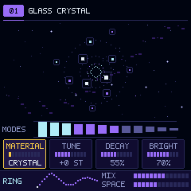
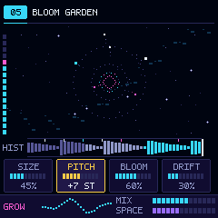
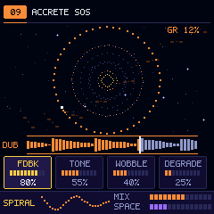
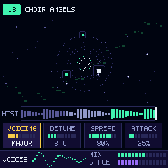
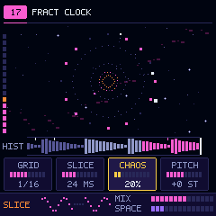
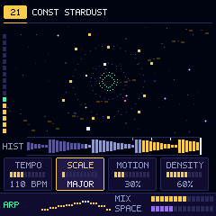
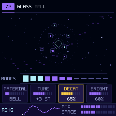
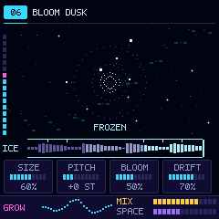
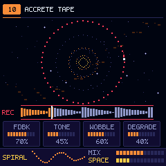
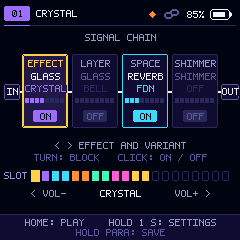

<p align="center">
  
</p>

<h1 align="center">Andromeda</h1>

<p align="center"><b>Granular, ambient and generative guitar firmware for the M-VAVE / Donner Pocket AMP pedal: six sound-design engines, a shared FDN reverb with shimmer, a secondary resonator layer, and a radar play screen running on dual pi32v2 cores.</b><br>
Free software (GPL-3.0-or-later), built with the open JieLi custom firmware ecosystem (see <a href="#credits">Credits</a>).</p>

> [!WARNING]
> ### Hardware Safety & Disclaimers
> Flashing custom firmware writes to the physical SPI-NOR flash memory of your device. While Andromeda enforces rigorous hardware-level write fencing (`pa_flash_rw_ok()`, blocking all writes below `0x004000`), provides A/B double-buffering for user stores, and includes automated recovery mechanisms, flashing firmware is undertaken at your own risk. The authors accept no liability for hardware damage, warranty invalidation, or data loss. Ensure your pedal's battery is adequately charged before initiating firmware flashing operations, and always take a verified full-chip backup first.

---

## Everything happens through the workbench and tools

Use **Chrome or Edge** (which support Web MIDI), a standard USB-C data cable, and the native Python / PowerShell host tools.

| Tool | What it does |
|---|---|
| [**Web Editor**](custom-fw/web/Andromeda_Web_Editor.html) | Connect over Web MIDI USB to manage presets P01–P20, adjust macro parameters, audition engines, and install firmware packages (`.bin` / `.fwsc`) with automatic sector safety verification. |
| [**Desktop Emulator**](custom-fw/emu/README.md) | The entire firmware DSP and UI running as a native Windows DLL (`pocket_amp_emu.dll`), served with an interactive HTML5 front panel at `http://localhost:8080`. Streams real-time 44.1 kHz audio with live guitar input or 15 clean DI captures by **Jonas Hemmersbach**. |
| [**WASM Workbench**](custom-fw/wasm/workbench.html) | Browser-based WebAssembly compilation of the Andromeda DSP graph and effect host for instant cross-platform verification and browser tests. |
| [**Flashing & Recovery Tools**](docs/ANDROMEDA-FLASHING.md) | Command-line verified flashing (`flash_unit.py`), partition readouts (`jl_safe_flash.py`), and ROM download-mode recovery (`pa_transporter.py`). |

---

## Target boards and hardware

The repository compiles for two hardware targets via `custom-fw/build.ps1 -Board <target>`:

| Target | Switch | Hardware specification |
|---|---|---|
| **Pocket AMP** *(Default)* | `-Board pocket_amp` | Targets the M-VAVE / Donner Pocket AMP hardware (240x240 ST7735S display, PARA encoder, five keys, MASTER pot). |
| **BlackBox** | `-Board blackbox` | Targets compatible JieLi AC791N hardware variants. |

---

## Your first install

1. **Take a full-chip backup.** Before writing anything to flash, create a byte-for-byte backup of your pedal using the recovery tool:
   ```powershell
   python custom-fw/tools/pa_transporter.py --timeout 300 dump backup/
   python custom-fw/tools/qa_recovery.py verify backup/dump1.bin backup/dump2.bin --record
   ```
2. **Build and package.** Compile the checked Andromeda firmware release package:
   ```powershell
   powershell -ExecutionPolicy Bypass -File custom-fw/build.ps1 -Product andromeda
   ```
   The verified release image is placed in `custom-fw/release/Pocket_AMP_Andromeda_<version>/`.
3. **Install.** 
   - **Via Web Editor:** Open `custom-fw/web/Andromeda_Web_Editor.html` in Chrome or Edge, click **Connect MIDI**, navigate to the **Firmware** tab, select `Pocket_AMP_Andromeda_<version>.bin` (or `.fwsc`), and click **Flash**.
   - **Via Command Line:**
     ```powershell
     python custom-fw/tools/flash_unit.py custom-fw/build_app.bin
     ```
4. **First boot.** The pedal restarts into Andromeda. On first cold boot, the firmware detects an uninitialised store and automatically formats the 20 preset slots (writing the 12 factory ambient chains to P01–P12 and preparing P13–P20 for user saves).

---

## Getting back

- **To the stock firmware:** In the Web Editor or via `pa_transporter.py`, restore the app partition (`0x4000..0x85FFF`) from your baseline backup dump:
  ```powershell
  python custom-fw/tools/pa_transporter.py --timeout 300 drill backup/dump1.bin 0x4000-0x86000 --repair --full-verify
  python custom-fw/tools/pa_transporter.py runapp
  ```
- **If the unit fails to boot:** Andromeda includes an automatic boot guard. If a boot does not complete within 5 seconds, the watchdog will trip the unit into mask ROM download mode. You can also force this manually by **holding the PARA encoder down for 2.5 seconds during power-on** (the screen remains black; the unit enumerates as `UBOOT1.00`, USB `4C4A:8057`).
- **Emergency unbrick (RP2040 Transporter dongle):** If the flash is erased or corrupted, an RP2040 dongle (such as a Seeed XIAO RP2040 connected to the USB-C port via three wires: D+, D-, GND) injects the ROM USB key at power-on, recovering the device over USB with no soldering required. See [RECOVERY.md](RECOVERY.md).

---

## What is in it

- **Six generative sound-design engines:** hosted within a 147 KB dynamic overlay in fast SRAM:
  - **GLASS:** 12 stereo tuned resonators excited by guitar transients or manual strikes (Crystal, Bell, Kalimba, Marimba).
  - **BLOOM:** Spectral grain cloud swelling, pitch-shifting, and freezing the history of your playing into lush pads (Garden, Dusk, Drift, Raw).
  - **ACCRETION:** 2-second stereo ADPCM tape loop that records, overdubs, degrades, and saturates with tape flutter and limiter feedback (SOS, Tape, Decay, Mirror).
  - **CHOIR:** Microtonal and interval vocal pitch-shifting swarm holding chords and octave detunes (Angels, Mourn, Deep, Infinite).
  - **FRACTURE:** Tempo-synced granular buffer slicer with reverse bursts, skips, and pitch hops locked to the internal BPM (Clock, Water, Heart, Skip).
  - **CONSTELLATION:** 16-step generative scale and arpeggio sequencer generating melodies from played guitar chords (Stardust, Gravity, Dance, Orbit).
- **Shared processing blocks:**
  - **SPACE:** 8-delay feedback-delay-network (FDN) reverb on every preset slot, with dedicated decay, size, tone, and send levels.
  - **SHIMMER:** Harmonic pitch octave / interval feedback climbing through the reverb tail (+12, +7, +12/+7, +19).
  - **LAYER:** Secondary tuned GLASS resonator running in parallel under any primary engine.
  - **Input & Dynamics:** Mono input conditioning, input limiter, 3-band parametric EQ, and soft-clip master ceiling.
- **Measured-cost dual-core allocator:** Core 0 runs the audio interrupt and UI; heavy effect chains automatically split early slots to Core 1 at a cost of 1 block (1.45 ms) latency. If Core 1 ever misses a deadline or faults, execution seamlessly reverts to Core 0 with zero audio dropouts.
- **Specifications:** 44,118 Hz codec rate, 64-sample blocks (1.45 ms), 24-bit audio I/O, 512 KB SRAM, 20 preset slots, chromatic tuner (< 2 cents accuracy), USB audio, USB MIDI, and BLE MIDI.

<p align="center">
  
  
  
  
  
</p>
<p align="center">
  
  
  
  
  
</p>

*Screen renders generated directly from the firmware UI renderer (`custom-fw/tools/render_screens.c`).*

---

## The guide

| Topic | Documentation & Resources |
|---|---|
| **Interface & Shortcuts** | [Controls & Physical Gestures](#the-interface) • [Signal Chain Page](docs/ANDROMEDA-DESIGN.md) • [Settings Menu](docs/ANDROMEDA-DESIGN.md) |
| **Engines & Sound Design** | [The Six Ambient Engines](#what-is-in-it) • [Effect Audibility Measurements](custom-fw/tools/effect_audibility.py) • [Design Specification](docs/ANDROMEDA-DESIGN.md) |
| **System Architecture** | [ARCHITECTURE.md](ARCHITECTURE.md) • [Dual-Core Performance & Latency](docs/ANDROMEDA-PERF.md) • [Memory & SRAM Overlay Map](ARCHITECTURE.md#5-memory) |
| **Flashing & Bench Protocol** | [Flashing Guide](docs/ANDROMEDA-FLASHING.md) • [QA Gate Protocol](TEST-PROTOCOL.md) • [Bench Checklist](docs/ANDROMEDA-FLASHING.md#bench-checklist) |
| **Backup & Recovery** | [RECOVERY.md](RECOVERY.md) • [Flash Map](RECOVERY.md#flash-map-1-mib-jedec-856014) • [RP2040 Transporter Dongle](custom-fw/tools/transporter/README.md) |
| **MIDI & Communication** | [MIDI Map Specification](custom-fw/MIDI-MAP-CUSTOM.md) • [SysEx Diagnostic Channel](custom-fw/tools/usb_midi_probe.py) • [Web Editor Protocol](custom-fw/tools/update_editor_andromeda.py) |
| **Licensing & Provenance** | [LICENSING.md](LICENSING.md) • [Third-Party Notice](NOTICE.md) • [Root License](LICENSE) • [Build Roadblocks & Provenance](LICENSING.md#how-we-got-our-build-working) |

---

## The interface

The pedal front panel features a 240x240 ST7735S colour display, five tactile switches (`HOME`, `VOL-`, `VOL+`, `<`, `>`), the `PARA` push-encoder, and the analog `MASTER` potentiometer.

| Physical Control | In the Play Screen | In a Block's Parameter Page | In the Signal Chain Page |
|---|---|---|---|
| **`PARA` turn** | Adjusts the active macro parameter | Hovers over knobs; when clicked, edits the value | Moves the cursor across the blocks |
| **`PARA` click** | Cycles focus across the 4 macro knobs | Selects hovered knob for editing (click again to deselect) | Toggles the active block ON or OFF |
| **`PARA` hold (1 s)** | Opens the Preset Save dialog | Opens the Preset Save dialog | Opens the Preset Save dialog |
| **`<` and `>`** | Engine actions (strike, freeze, dub, burst, reroll) | Navigates parameters | Moves block selection cursor |
| **`<` hold (0.8 s)** | Resets engine (erases tape, clears grains, rings) | Resets parameter to default | — |
| **`HOME` tap** | Opens the Signal Chain view | Returns to the Signal Chain view | Opens the selected block's edit page |
| **`HOME` hold (1 s)** | Opens the System Settings menu | Opens the System Settings menu | Opens the System Settings menu |
| **`VOL-` / `VOL+`** | Steps through presets P01–P20 | Cycles through active blocks in preset | Cycles effect variant or block types |
| **`VOL-` / `VOL+` hold** | Fast preset decrement / increment (0.8 s) | Steps presets while staying on page | Steps presets while staying on chain |
| **`VOL-` + `VOL+`** | Toggles the Chromatic Tuner (with audio mute) | Toggles the Chromatic Tuner | Toggles the Chromatic Tuner |
| **`PARA` hold at boot** | Forces mask ROM download mode (2.5 s) | — | — |

The analog **MASTER** knob controls output volume via an analog-taper linear slew with dither.

---

## Build it on your computer

Requirements: Windows 10/11 with PowerShell, Python 3.10+, LLVM/Clang (LLVM-MinGW or WinGet MartinStorsjo.LLVM-MinGW), the JieLi pi32v2 toolchain (`$env:PI32_ROOT` or `C:\JL\pi32`), and Node.js for WASM suites. The emulator also requires NumPy and python-sounddevice.

```powershell
# Clone the repository
git clone https://github.com/28spawn/Andromeda.git
cd Andromeda

# 1. Build and package Andromeda firmware (runs host tests, compiles device ELF, packages .fwsc/.bin)
powershell -ExecutionPolicy Bypass -File custom-fw/build.ps1 -Product andromeda

# 2. Run the automated static, build, unit, functional and image QA gate
python custom-fw/tools/qa_gate.py

# 3. Launch the desktop emulator with real-time audio and browser front panel
powershell -ExecutionPolicy Bypass -File custom-fw/emu/run_emu.ps1
```

### Build Pipeline Safety Features

- **Strict fail-fast pipeline:** `build.ps1` wraps all compilers and native commands in `Invoke-Checked`, ensuring zero-tolerance for ignored native exit codes.
- **Clean object directory:** `custom-fw/build_pi32` is deleted and recreated on every build run to eliminate stale object link hazards.
- **Source drift guard:** `custom-fw/sources.txt` guarantees every C file is tracked across all targets; checked at stage `[1/5]` by `check_sources.py`.
- **Exact section load extraction:** `llvm-nm.exe` extracts exact load addresses (`_rt_load`, `_c1_load`, `_rf_load`, `_ff_load`, `_data_load`), preventing 48-byte initialized variable displacement and packing `.flashfn` directly at its execution address.
- **Circular runtime library scanning:** Encloses `libcompiler_rt.a`, `libm.a`, and `libc.a` in `--start-group ... --end-group` to resolve soft-float `__subdf3` symbols.
- **Vendor-free packaging:** Packages only open-source code and public Apache-2.0 SDK configuration blobs; contains no proprietary vendor binaries.

See [LICENSING.md](LICENSING.md#how-we-got-our-build-working) for the complete engineering chronicle.

---

## Repository map

```text
custom-fw/
  include/       Firmware interfaces, configuration (pa_config.h), and engine headers
  src/board/     Hardware drivers (ST7735S, ALNK audio codec, SPI NOR, GPIO buttons, USB/BLE)
  src/dsp/       Fixed-point math primitives, biquads, tuner, and hardware accelerator stubs
  src/fx/        The six ambient engines (v1_*.c), FDN reverb, shimmer, and two-core graph allocator
  src/sys/       Audio core, SMP core 1 worker, presets, store, SysEx, and diagnostic channels
  test/          Automated C and Python regression suites and host simulation harnesses
  emu/           Native desktop emulator DLL, Jonas Hemmersbach DI audio loops, and browser UI
  wasm/          WebAssembly build and browser workbench
  tools/         Build scripts, packaging utilities (onyx_pkg_make.py), and flash recovery tools
  qa/            Hardware evidence ledger, test reports, and baseline dumps
  build.ps1      Checked Windows build and packaging pipeline
docs/            Flashing guides, performance measurements, architecture and plan documents
ARCHITECTURE.md  Modules, execution contexts, audio path, and memory layout
TEST-PROTOCOL.md Automated QA gate and hardware bench test protocol
RECOVERY.md      Flash map, backup instructions, and Transporter unbrick runbook
NOTICE.md        Third-party acknowledgements and audio credits
LICENSING.md     Full legal provenance, component terms, and build breakdown
```

---

## AI-assisted development

This project was developed through human-in-the-loop pair programming with AI models (Anthropic Claude and Google DeepMind Antigravity / Gemini). The maintainer (@28spawn) architected the system, directed the implementation, designed the sound engines, and verified all firmware on real hardware; DSP routines, UI drivers, host simulations, and test suites were authored and reviewed with AI assistance. Every change passes automated static analysis, host unit suites, and the QA gate before being flashed to physical hardware.

---

## Credits

Andromeda stands on the foundational work of the open-source JieLi and Pocket AMP developer community. Each imported or derived component is marked in its source files and detailed in [LICENSING.md](LICENSING.md):

- **[Optimist](https://github.com/w0ts/optimist)** by hdavid, Leo Kuroshita (@kurogedelic), Hügelton Instruments, and the Optimist contributors: The low-level Bluetooth LE MIDI stack for the AC791N / WL82 radio, radio register analysis, and documentation.
- **[Pendel](https://github.com/hugelton/Pendel)** & **[pendel-bsp](https://github.com/hugelton/pendel-bsp)** by Leo Kuroshita (@kurogedelic), Hügelton Instruments: The open update loader architecture, package container layout, and hardware abstraction layer (MPL-2.0).
- **[Melodee](https://github.com/keremimo/melodee)** by Kerem Kilic (Ellic Studio) and Adrien Tibi (Recursive Field Instruments): The dual-core SMP task runner and USB MIDI host foundation (MPL-2.0).
- **Jonas Hemmersbach:** Self-captured dry guitar direct input (DI) recordings (chords, lead licks, rhythm riffs) used in the desktop emulator and workbench.
- **Public JieLi AC79 AIoT SDK:** Zhuhai Jieli Technology Co., Ltd. (Apache-2.0), referenced for public register sequences and boot configuration binaries.

Unofficial: Andromeda is an independent research and interoperability project. It is not made, endorsed, or supported by Zhuhai Shengke Electronics Co., Ltd. (M-VAVE), Donner, or Zhuhai Jieli Technology Co., Ltd. All trademarks belong to their respective owners.

---

## Licence and contributing

- **Source code:** Licensed under the **GNU General Public License v3.0 or later** (`GPL-3.0-or-later`, full text in [LICENSE](LICENSE)).
- **Sub-components:** Update loader and OTA session are **MPL-2.0**; Bluetooth LE stack is **GPL-3.0-only OR MPL-2.0**; radio configuration data and SDK blobs are **Apache-2.0**. Full legal provenance is mapped in [LICENSING.md](LICENSING.md).
- **Contributions:** Contributions are welcomed under `GPL-3.0-or-later` (or `MPL-2.0` for loader/BLE files). Please ensure all changes pass `build.ps1` and `python custom-fw/tools/qa_gate.py` before submitting a pull request.
